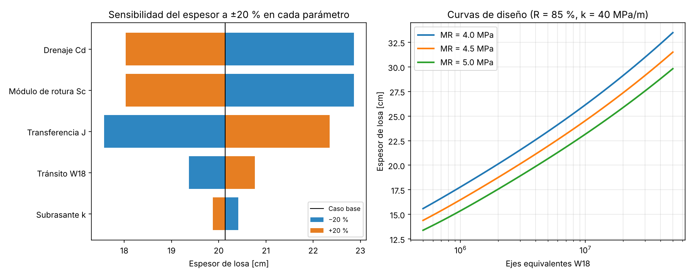

# Diseño de pavimento rígido — AASHTO 93

Calculadora en Python del espesor de losa de concreto según la **Guía AASHTO 1993**, con un análisis de sensibilidad para entender qué parámetros controlan realmente el diseño.

Nació como complemento de mi investigación sobre el comportamiento térmico de pavimentos rígidos en zonas altoandinas ([pavimento-fourier-heladas-cusco](https://github.com/261893-web/pavimento-fourier-heladas-cusco)): antes de estudiar las tensiones por temperatura quería tener claro de dónde sale el espesor de la losa.



## La ecuación

AASHTO 93 relaciona el tránsito admisible con el espesor `D`:

```
log10(W18) = ZR·S0 + 7.35·log10(D+1) − 0.06
           + log10(ΔPSI / 3.0) / [1 + 1.624·10⁷ / (D+1)^8.46]
           + (4.22 − 0.32·pt) · log10{ Sc·Cd·(D^0.75 − 1.132) / [215.63·J·(D^0.75 − 18.42/(Ec/k)^0.25)] }
```

Como `D` aparece en varios términos no lineales, no se puede despejar. En lugar de usar el nomograma, el código busca la raíz con el **método de Brent** (`scipy.optimize.brentq`), que converge en pocas iteraciones y no depende de un valor inicial.

## Uso

```python
from aashto93 import ParametrosRigido, espesor_requerido

p = ParametrosRigido(W18=5.1e6, R=0.95, S0=0.29, p0=4.2, pt=2.5,
                     Sc=650, Ec=5e6, k=72, J=3.2, Cd=1.0)
espesor_requerido(p)   # -> 9.72 pulg
```

Para el caso de aplicación (vía colectora en Cusco, f'c = 280 kg/cm², MR = 4.5 MPa, k = 40 MPa/m, 3 millones de EE):

```bash
pip install -r requirements.txt
python diseno_cusco.py
```

```
Espesor requerido: 7.93 pulg = 20.1 cm
Espesor constructivo: 21 cm
```

## Validación

| Prueba | Detalle |
|---|---|
| Ejemplo de la Guía AASHTO (Fig. 3.7) | El nomograma da ≈ 10.0 pulg; la ecuación resuelta numéricamente da 9.72 pulg. La diferencia es la típica entre lectura gráfica y cálculo exacto. |
| Valores de ZR | Coinciden con la tabla de la guía (R = 90 % → −1.282; 95 % → −1.645). |
| Consistencia | El espesor encontrado reproduce W18 con error < 10⁻⁶ en log10. |
| Tendencias físicas | Más tránsito → más espesor; mayor módulo de rotura → menos espesor. |

## Lo que muestra la sensibilidad

Con una variación de ±20 % en cada parámetro, el **módulo de rotura del concreto**, el **coeficiente de drenaje** y la **transferencia de carga J** mueven el espesor bastante más que el propio tránsito. El módulo de reacción `k` casi no influye. En la práctica eso significa que vale más la pena controlar la calidad del concreto y usar pasadores en las juntas que afinar el conteo vehicular o mejorar la subrasante.

## Limitaciones

- Usa `k` efectivo directamente; no incluye la corrección por pérdida de soporte (LS) ni la variación estacional.
- No calcula el tránsito (EE) a partir del conteo vehicular; se ingresa ya como W18.
- El diseño por fatiga y erosión de la PCA, o el método mecanístico-empírico, darían resultados distintos.

## Referencias

- AASHTO (1993). *Guide for Design of Pavement Structures*.
- MTC Perú (2014). *Manual de Carreteras: Suelos, Geología, Geotecnia y Pavimentos*.
